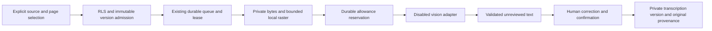

# Optional reviewed OCR — disabled by default

Raster work itself is globally bounded to one leased OCR pipeline, before provider reservation. The generic text claimer excludes OCR. Cancellation keeps an in-flight raster lease until the worker exits/releases it or its bounded expiry, so a cancellation cannot bypass that limit. Existing queue recovery and increasing fences handle a lost pre-send worker without duplicating an uncertain provider request.

Local PDF/text extraction remains first. Explicit **Extract text** admission accepts only a current authorized PNG/JPEG or one/two selected scanned PDF pages, including a scanned page within a mixed text/image PDF. Rendering refuses any selected page already containing local text before provider reservation. It cannot accept remote image URLs or reopen the quarantined prescription-scan handler. That handler's prescription-reading intent is retained, but its guessing instructions, clinical extraction schema, raw-response logging and model fallback loop are not reused.

The existing `document_jobs`, Auth/RLS, 90-second lease/fence, aggregate provider allowance, operation budget and source invalidation paths are reused. A source's same actor/version/revision admits one OCR job; same-key requests reconcile it. Original private bytes are loaded and hash-checked on the server. Local rendering has a 15-second worker deadline and 256 MiB JS heap limit; this does not claim a native-memory security boundary. Input is at most 4 MiB, images at most 4096px per side / 8 million pixels, PDF at most 20 total pages and two selected scanned pages. Local text pages are refused. Rendering caps each side at 1600px and the combined PNG output at 2 MiB. No image is persisted publicly.

Before provider transmission, the existing durable ledger reserves one request, the conservative 50,000 input bound and 3,000 output tokens. Account/model image-token accounting must be reconciled before live capability is marked verified. Concurrency, pacing and aggregate/day/actor caps remain authoritative. Unknown outcomes retain reservation and cannot automatically resend; retained validated responses can publish through the same fence without a new call. Cancel/revoke/replace/delete hide stale drafts and prevent publication. A cancelled sent attempt retains its expiry so recovery can release active accounting without refunding consumption.

The proposed configurable vision ID is `qwen/qwen3.8-27b`. This is a requested configuration, **not verified multimodal access or quality**. No fallback model is chosen. `OCR_ENABLED`, `NEXT_PUBLIC_OCR_ENABLED` and `OCR_PROVIDER_VERIFIED` default false; `LIVE_OCR_AUTHORIZATION_REF` defaults empty. No key/flag alone bypasses the durable allowance. `GROQ_API_KEY` stays server-only. Tests inject an offline provider and forbid external requests.

Output is a page-numbered draft, not clinical facts or an approved record. Literal Hindi/English, numbers, units and negation are preserved by contract; unreadable spans must be `[unclear]`, with no medicine/dose guesses. Provider confidence is explicitly uncalibrated. Software cannot establish image truth from a model's claim: users must compare each page, correct text and confirm review. Saving creates a separate manual transcription version via the existing immutable Storage/upload/SQL saga, with exact original version/page, reviewer, model/mode and job provenance. It clears grants; sharing the new version is explicit. OCR never approves a consultation or creates prescriptions. Manual transcription remains independent.

The additive `202610250001_reviewable_ocr.sql` is prepared for fresh/legacy isolated CI rehearsal. It has **not been applied to the hosted preview**. Keep flags off against that older schema. `/design/ocr` is a clearly labelled nonpersistent UI fixture; it is not authenticated OCR or live-provider evidence. Real isolated tests cover the persisted review path and denials separately.

OCR jobs reuse the thread authority for scope and budgets but are excluded from the evidence-chat listing and cannot share a thread with question/answer jobs. A read-only poll never calls the provider. The reviewed transcription contains only selected pages; original page ordering is retained in provenance and the full original remains available to its owner. Neither draft generation nor transcription review is clinical approval.
