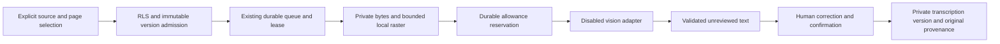

# Optional reviewed OCR — disabled by default

Raster work itself is globally bounded to one leased OCR pipeline, before provider reservation. The generic text claimer excludes OCR. Cancellation keeps an in-flight raster lease until the worker exits/releases it or its bounded expiry, so a cancellation cannot bypass that limit. Existing queue recovery and increasing fences handle a lost pre-send worker without duplicating an uncertain provider request.

Local PDF/text extraction remains first. Explicit **Extract text** admission accepts only a current authorized PNG/JPEG or one/two selected scanned PDF pages, including a scanned page within a mixed text/image PDF. Rendering refuses any selected page already containing local text before provider reservation. It cannot accept remote image URLs or reopen the quarantined prescription-scan handler. That handler's prescription-reading intent is retained, but its guessing instructions, clinical extraction schema, raw-response logging and model fallback loop are not reused.

The existing `document_jobs`, Auth/RLS, 90-second lease/fence, aggregate provider allowance, operation budget and source invalidation paths are reused. A source's same actor/version/revision admits one OCR job; same-key requests reconcile it. Original private bytes are loaded and hash-checked on the server. Local rendering has a 15-second worker deadline and 256 MiB JS heap limit; this does not claim a native-memory security boundary. All controlled canvas allocations additionally share a32MiB RGBA bookkeeping ceiling and4096-side/8-million-pixel bounds; native decode buffers, PDF images/caches, encoder and allocator overhead are outside that ceiling. No hard process RSS guarantee is claimed. A process-level raster slot covers page-preview requests too and is released only after worker termination. One20-second bounded waiter lets a two-page review load both originals serially; a third concurrent request is refused. Waiting cancellation removes its slot before native work starts. The queue lease provides separate global job admission; it does not claim a cross-function global page-preview limiter. Input is at most 4 MiB, images at most 4096px per side / 8 million pixels, PDF at most 20 total pages and two selected scanned pages. Local text pages are refused. Rendering caps each side at 1600px and the combined PNG output at 2 MiB. No image is persisted publicly.

One request-bound calculation covers admission, reservation, SDK output cap and retained provenance. It counts the exact system prompt plus page-number instruction as UTF-8 bytes (a conservative bound only for the supplied/reconciled byte-level tokenizer), supplied chat-framing overhead and the documented model image rule. Groq's [vision reference](https://console.groq.com/docs/vision), checked26 October2026, documents 2,048 input tokens per Qwen3.8 image. No account entitlement is inferred. `OCR_ACCOUNTING_JSON` is required and empty by default; only the supported documented live formula is accepted. Unknown model/accounting, oversized/context-exceeding requests and missing request ceilings deny a send. Admission uses the maximum rendered envelope, and reservation recomputes actual dimensions with the same formula. The selected output cap is exact, at most3,000; neither worker nor provider silently increases it. Both durable ledgers must supply matching OCR per-request ceilings as well as existing aggregate/day/pacing/scope caps. Valid integer reported usage is retained; missing/invalid usage keeps conservative reservation. An uncertain attempt is never refunded or resent. Result provenance retains the calculation and usable usage. This is bound validation, not an accuracy guarantee.

The proposed configurable vision ID is `qwen/qwen3.8-27b`. This is a requested configuration, **not verified multimodal access or quality**. No fallback model is chosen. `OCR_ENABLED`, `NEXT_PUBLIC_OCR_ENABLED` and `OCR_PROVIDER_VERIFIED` default false; `LIVE_OCR_AUTHORIZATION_REF` defaults empty. No key/flag alone bypasses the durable allowance. `GROQ_API_KEY` stays server-only. Tests inject an offline provider and forbid external requests.

Output is a page-numbered draft, not clinical facts or an approved record. Explicit blank pages carry empty text; fully unreadable pages carry `[unclear]` and an explanation. Markers/explanations must agree. On owner confirmation, an unchanged blank becomes a visibly labelled owner-reviewed blank-page annotation, never invented clinical text. Missing/extra/reordered/duplicate pages, malformed/oversized values and any non-stop finish are rejected. Literal Hindi/English, numbers, units and negation are preserved by contract; unreadable spans must be `[unclear]`, with no medicine/dose guesses. Provider confidence is explicitly uncalibrated. Software cannot establish image truth from a model's claim: users must compare each page, correct text and confirm review. Saving creates a separate manual transcription version via the existing immutable Storage/upload/SQL saga, with exact original version/page, reviewer, model/mode and job provenance. It clears grants; sharing the new version is explicit. OCR never approves a consultation or creates prescriptions. Manual transcription remains independent.

The additive `202610250001_reviewable_ocr.sql` is prepared for fresh/legacy isolated CI rehearsal. It has **not been applied to the hosted preview**. Keep flags off against that older schema. `/design/ocr` is a clearly labelled nonpersistent UI fixture; it is not authenticated OCR or live-provider evidence. Real isolated tests cover the persisted review path and denials separately.

OCR jobs reuse the thread authority for scope and budgets but are excluded from the evidence-chat listing and cannot share a thread with question/answer jobs. A read-only poll never calls the provider. The reviewed transcription contains only selected pages; original page ordering is retained in provenance and the full original remains available to its owner. Neither draft generation nor transcription review is clinical approval.

Schema guards fail closed on absent optional RPCs even if a flag is flipped; disabled normal document/manual clinical/account/worker paths continue on the older accepted schema. Evidence retains transcription page ordinal and separate original page/version mapping, including nonascending selections. A stale cited version cannot silently navigate to the newer source. See [the prepared additive package](optional-rollout.md).
